<p align="center">
  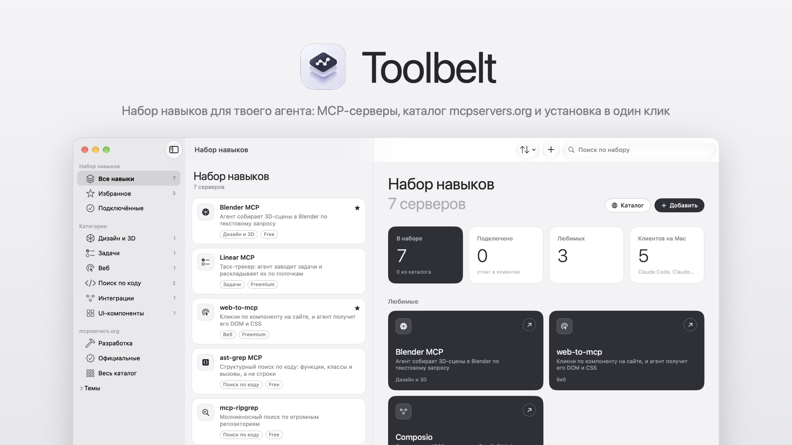
</p>

<h1 align="center">Toolbelt: набор навыков для агента на macOS</h1>

<p align="center">
  Нативное приложение на SwiftUI для тех, кто подключает агентам MCP-серверы.<br>
  Свой набор серверов с описаниями и конфигами, живой каталог mcpservers.org и установка в MCP-клиенты одной кнопкой.
</p>

<p align="center">
  <a href="https://github.com/mrgsdev/Toolbelt/releases/latest"></a>
</p>

<p align="center">
  
  <a href="https://github.com/mrgsdev/Toolbelt/releases"></a>
  
  
</p>

<p align="center">
  📬 <a href="mailto:mrgsdev@gmail.com">mrgsdev@gmail.com</a> &nbsp;·&nbsp;
  🌐 <a href="https://mcpservers.org/ru">Каталог mcpservers.org</a>
</p>

---

## Коротко

**Набор навыков:** ваши MCP-серверы с описанием, возможностями, шагами установки, готовым JSON-конфигом,
примерами запросов, тегами, заметками и оценкой. Категории, избранное, «Подключённые», поиск с подсветкой.
Приложение стартует пустым, а на главной есть рекомендация разработчика из семи серверов.

**Каталог:** живой mcpservers.org прямо в окне: «Разработка» (4 500+ серверов), «Официальные», весь каталог
и 14 тем, поиск по всему каталогу, README, команды и конфиг каждого сервера. Добавить в набор можно в один клик.

**Установка:** конфиг сервера записывается в Claude Code, Claude Desktop, Cursor, VS Code, Windsurf, Gemini CLI,
Codex или LM Studio одной кнопкой. Перед записью делается копия файла, сервер можно и убрать из клиента.

**Мелочи:** знакомство с приложением, меню «Разделы» и «Сервер» с горячими клавишами, справка по ним (⌘/),
светлая и тёмная тема, проверка обновлений на GitHub.

## Что нового в 1.0

- Первая версия: набор навыков, каталог mcpservers.org, установка в восемь MCP-клиентов.
- Рекомендация разработчика на главной: Blender MCP, Linear MCP, web-to-mcp, ast-grep MCP, mcp-ripgrep,
  Composio и shadcn MCP. Добавляется по одному или целиком, блок можно скрыть.
- Строгий монохромный дизайн, светлая и тёмная тема, знакомство с приложением, справка и проверка обновлений.

Изменения всех версий: [Releases](https://github.com/mrgsdev/Toolbelt/releases).

## Содержание

- [Набор навыков](#набор-навыков)
- [Каталог mcpservers.org](#каталог-mcpserversorg)
- [Установка в MCP-клиенты](#установка-в-mcp-клиенты)
- [Знакомство, справка и обновления](#знакомство-справка-и-обновления)
- [Оформление и горячие клавиши](#оформление-и-горячие-клавиши)
- [Установка](#установка)
- [Для разработчиков](#для-разработчиков)
- [Лицензия](#лицензия) · [Отказ от ответственности](#отказ-от-ответственности)

---

## Набор навыков

### 🏠 Главная

Сколько серверов в наборе, сколько подключено и в избранном, какие MCP-клиенты найдены на Mac. Ниже карточки
любимых серверов, список клиентов с числом серверов в каждом конфиге и категории.

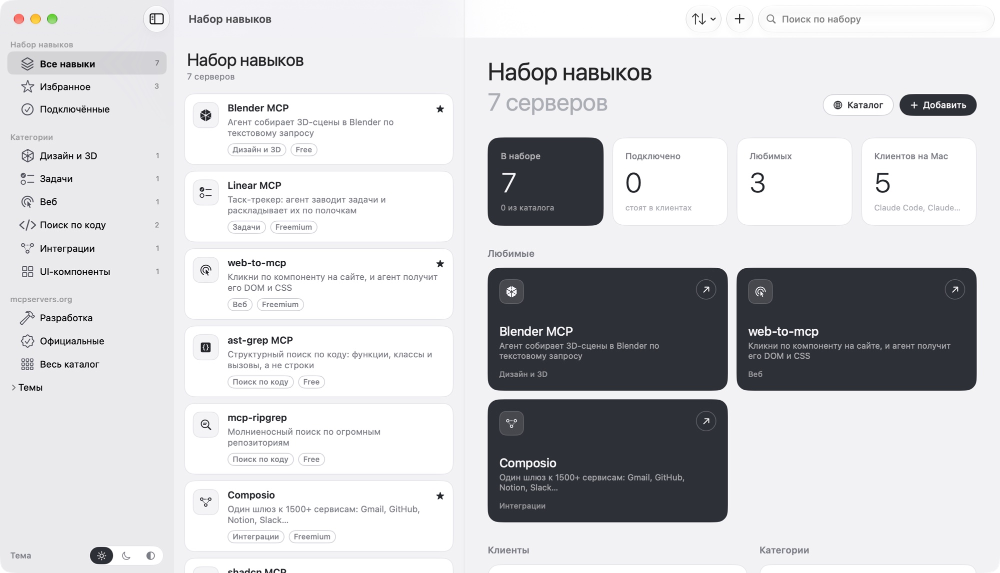

### ✨ Рекомендация разработчика

Toolbelt стартует пустым. На главной есть блок с семью серверами, с которых стоит начать: у каждого короткое
описание и комментарий разработчика. Их можно добавлять по одному или все сразу, а блок скрыть крестиком.
Вернуть его можно в Настройках или в меню сортировки списка.

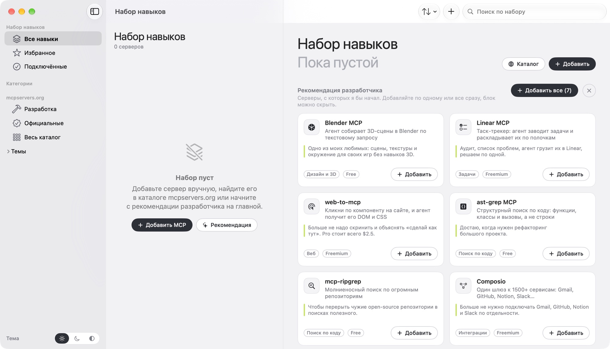

| Сервер | Зачем |
| --- | --- |
| [Blender MCP](https://blendermcp.org/setup) | агент собирает 3D-сцены в Blender по запросу |
| [Linear MCP](https://linear.app/docs/mcp) | агент заводит и раскладывает задачи в Linear |
| [web-to-mcp](https://web-to-mcp.com/) | клик по компоненту на сайте отдаёт агенту его DOM и CSS |
| [ast-grep MCP](https://github.com/ast-grep/ast-grep-mcp) | структурный поиск по коду для рефакторинга |
| [mcp-ripgrep](https://github.com/mcollina/mcp-ripgrep) | быстрый поиск по огромным репозиториям |
| [Composio](https://composio.dev/mcp-gateway) | один шлюз к 1500+ сервисам |
| [shadcn MCP](https://ui.shadcn.com/docs/mcp) | агент сам находит и ставит UI-компоненты |

### 🗂 Список и поиск

Три колонки, как в «Почте»: разделы, список серверов и карточка. Разделы «Все навыки», «Избранное»,
«Подключённые» и категории с количеством. Поиск в панели окна (⌘F) ищет по названию, тегам, описанию,
возможностям и заметкам и подсвечивает совпадения. Сортировка: «Сначала новые», «По названию», «По оценке».
По списку можно ходить стрелками ↑ ↓, правый клик открывает быстрые действия.

### 📦 Карточка сервера

Три вкладки. **Обзор:** в скольких клиентах установлен, оценка, возможности, общая информация (категория, цена,
источник, сайт, репозиторий), описание, примеры запросов (клик копирует запрос) и теги. **Установка:** клиенты,
шаги и конфиг. **Заметки:** оценка звёздами и свои заметки. Те же действия есть в меню «Сервер».

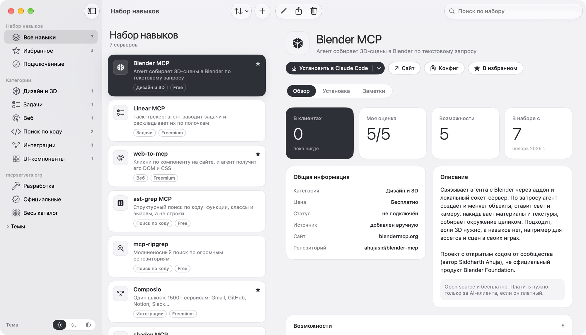

### ✍️ Свой сервер

Редактор (⌘N): название, описание, категория, цена, иконка из набора SF Symbols, ссылки, шаги установки
(можно писать `код` в обратных кавычках), конфиг с проверкой JSON и вставкой из буфера, возможности
в формате «tool: описание», примеры запросов, теги, статус и оценка.

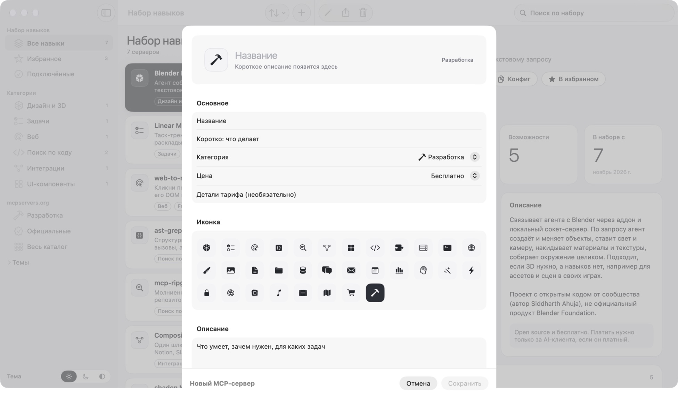

## Каталог mcpservers.org

### 🌐 Разделы

«Разработка», «Официальные», «Весь каталог» (⌘4…⌘6) и 14 тем: продуктивность, базы данных, поиск,
веб-скрейпинг, файловая система, контроль версий, коммуникации, облака, маркетинг, финансы, дизайн, память
и другое. Порядок «Новые» или «А–Я», бесконечная прокрутка, логотипы серверов, отметка «в наборе» у тех,
что уже добавлены.

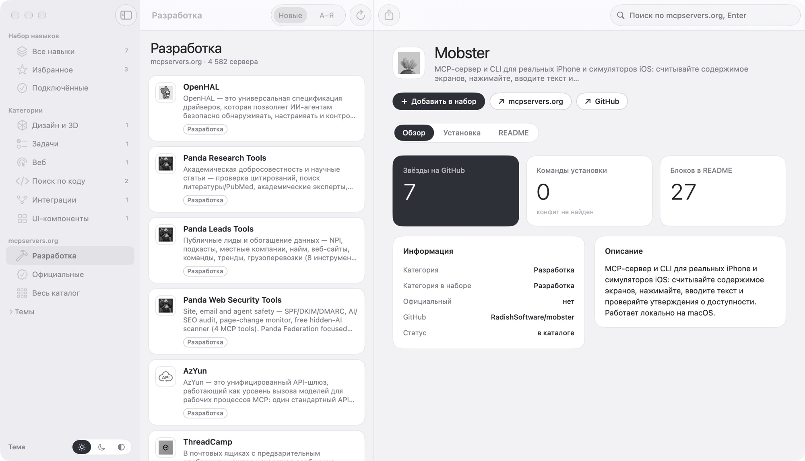

### 🔍 Поиск и README

В разделе каталога введите запрос в поле поиска и нажмите Enter: поиск идёт по всему каталогу. В карточке
сервера три вкладки: обзор со звёздами на GitHub, установка с командами и конфигом, найденными в README,
и сам README с заголовками, списками и кодом. «Добавить в набор» переносит всё в набор, и сервер можно
сразу поставить в клиент.

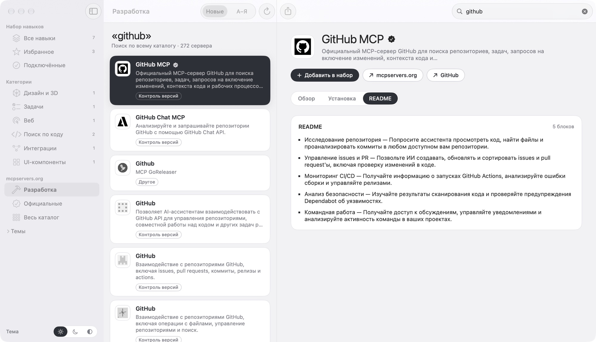

## Установка в MCP-клиенты

### ⚡ Одной кнопкой

Тёмная кнопка в карточке ставит сервер в выбранный клиент, стрелка рядом выбирает другой или убирает сервер
из клиента. На вкладке «Установка» (⌘I) видны все клиенты: где сервер уже стоит, где его можно поставить,
какой клиент не найден, и кнопка, которая показывает файл конфига в Finder. Клиент по умолчанию выбирается
в Настройках.

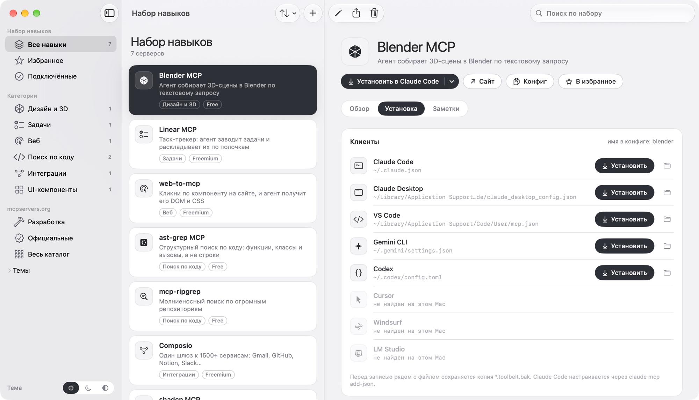

| Клиент | Файл | Как пишется |
| --- | --- | --- |
| Claude Code | `~/.claude.json` | `claude mcp add-json -s user` |
| Claude Desktop | `~/Library/Application Support/Claude/claude_desktop_config.json` | блок `mcpServers` |
| Cursor | `~/.cursor/mcp.json` | блок `mcpServers` |
| VS Code | `~/Library/Application Support/Code/User/mcp.json` | блок `servers` с полем `type` |
| Windsurf | `~/.codeium/windsurf/mcp_config.json` | блок `mcpServers` |
| Gemini CLI | `~/.gemini/settings.json` | блок `mcpServers` |
| Codex | `~/.codex/config.toml` | таблица `[mcp_servers.<имя>]` |
| LM Studio | `~/.lmstudio/mcp.json` | блок `mcpServers` |

- Перед записью рядом с файлом сохраняется копия `*.toolbelt.bak`, остальное содержимое файла не меняется.
- Если в конфиге остались заглушки вроде `<YOUR_UNIQUE_ID>` или `/absolute/path/to`, перед установкой
  появится предупреждение.
- Файлы с комментариями (JSONC) приложение не трогает и показывает ошибку.
- После установки в Claude Desktop его нужно перезапустить, остальные клиенты подхватывают сервер сами
  или в новой сессии.

## Знакомство, справка и обновления

### 👋 Знакомство с приложением

При первом запуске Toolbelt показывает знакомство из шести шагов: набор, каталог, установка, клавиши и тема,
слово от разработчика. На каждом шаге настоящий кусочек интерфейса. На последнем можно сразу добавить
рекомендацию разработчика. Снова открывается в меню «Справка».

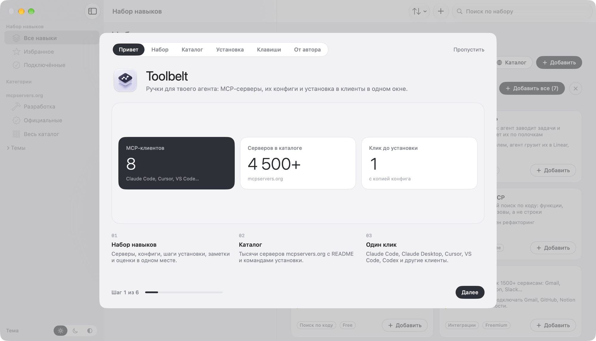

<details>
<summary>Шаг «Установка в клиенты»</summary>

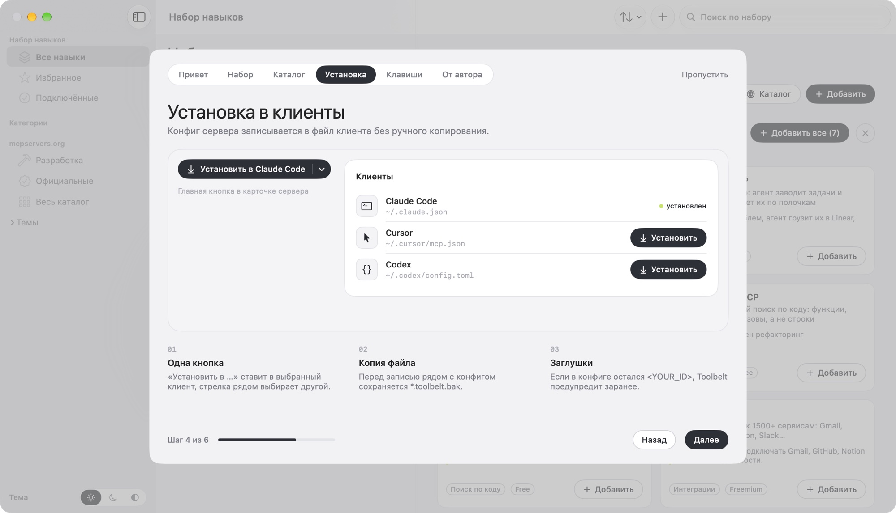

</details>

### ❓ Справка

Меню «Справка»: знакомство с Toolbelt, горячие клавиши (⌘/), страница на GitHub, «Сообщить о проблеме»,
отказ от ответственности и лицензия. «О программе Toolbelt» показывает версию, каталог и разработчика.

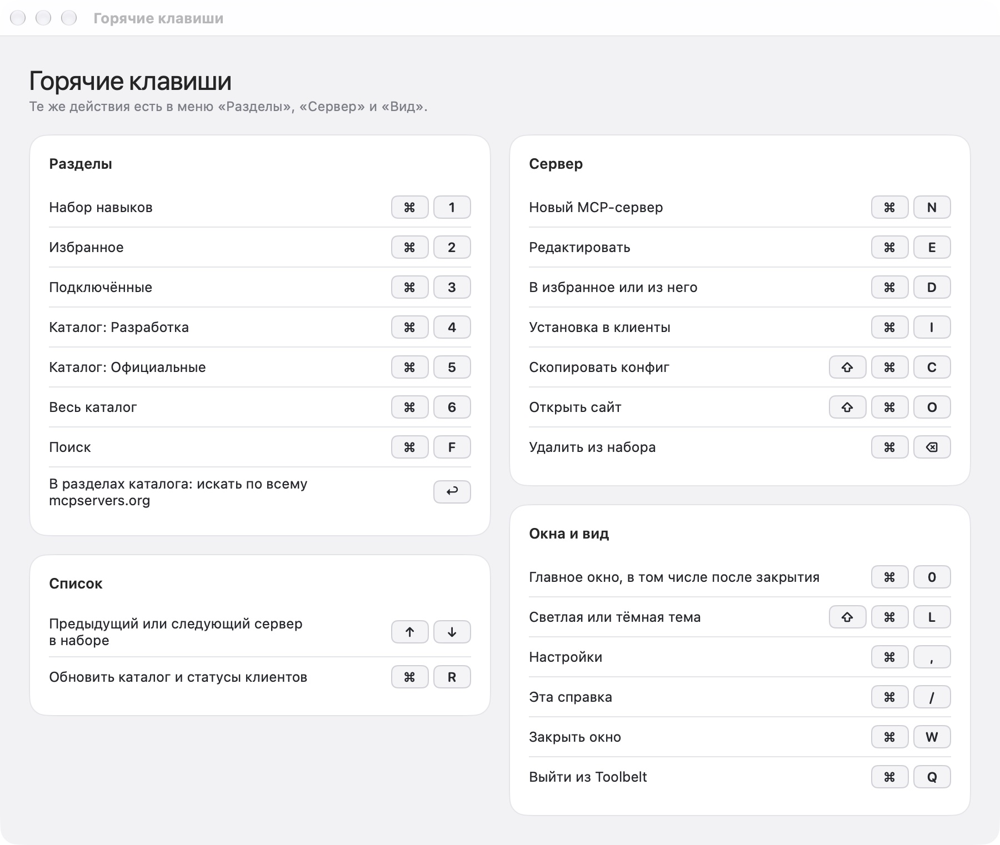

### 🔄 Обновления

Toolbelt сам проверяет новые релизы на GitHub при запуске и не чаще двух раз в день, а по запросу через
«Проверить обновления…». В окне обновления видно, что нового, и есть кнопки «Скачать», «Позже» и
«Пропустить эту версию». Приложение подписано без сертификата разработчика, поэтому новую версию оно
не ставит само: скачайте `.dmg` и замените приложение в «Программах», набор и настройки сохранятся.

## Оформление и горячие клавиши

### 🌗 Светлая и тёмная тема

Мягкий графит вместо чёрного и один лаймовый акцент для статусов. Тема переключается внизу сайдбара,
в Настройках (⌘,) с превью, в меню «Вид» или сочетанием ⇧⌘L. Можно оставить «Как в системе». Тема
применяется ко всему приложению: к окнам, листам, меню и «О программе».

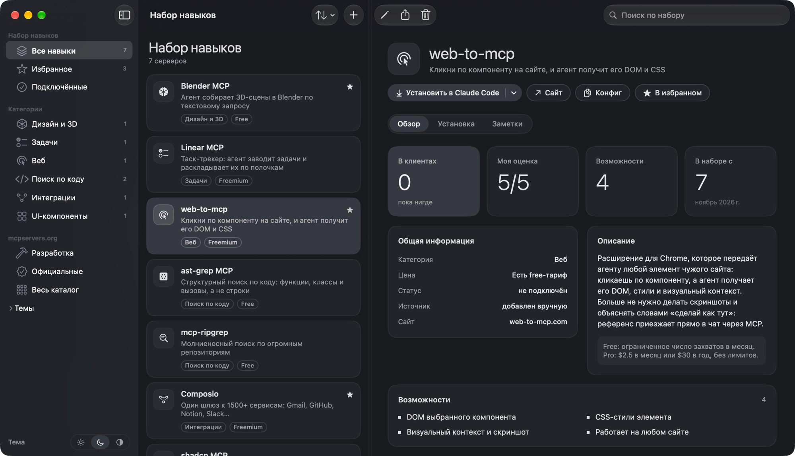

<details>
<summary>Главная в тёмной теме и настройки</summary>

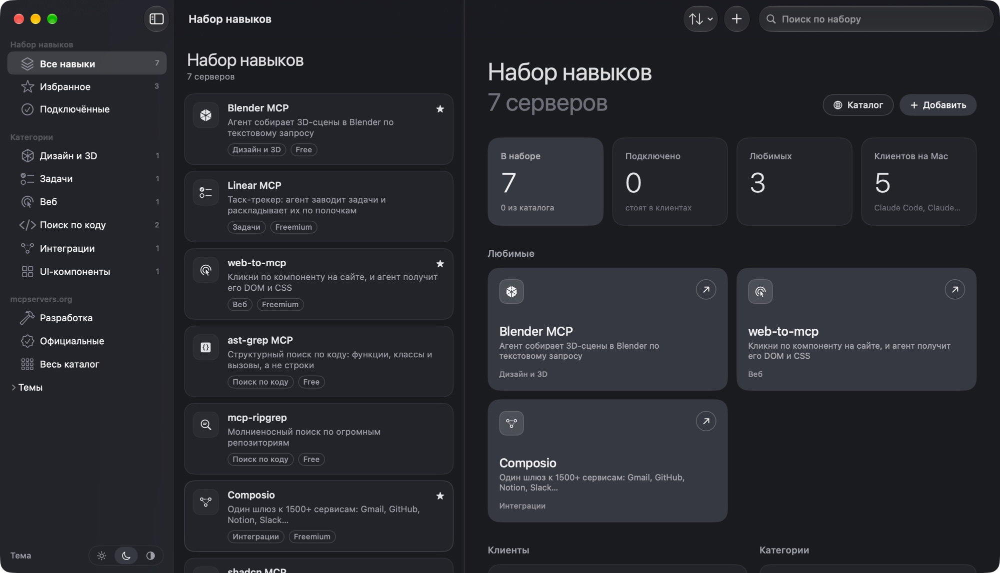
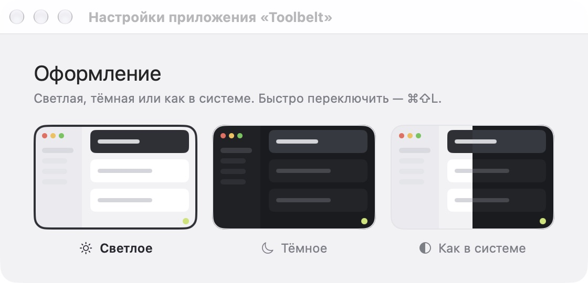

</details>

### ⌨️ Горячие клавиши

| Сочетание | Действие |
| --- | --- |
| ⌘1 · ⌘2 · ⌘3 | все навыки, избранное, подключённые |
| ⌘4 · ⌘5 · ⌘6 | каталог: разработка, официальные, весь каталог |
| ⌘F | поиск |
| Enter в поиске | искать по всему каталогу (в разделах каталога) |
| ⌘N | новый MCP-сервер |
| ⌘E · ⌘D · ⌘I | редактировать, в избранное, установка в клиенты |
| ⇧⌘C · ⇧⌘O | скопировать конфиг, открыть сайт |
| ⌘⌫ | удалить из набора |
| ⌘R | обновить каталог и статусы клиентов |
| ⌘0 | главное окно, в том числе после закрытия |
| ⇧⌘L | светлая или тёмная тема |
| ⌘, · ⌘/ | настройки, справка по клавишам |
| ↑ ↓ | ходить по списку набора |

## Установка

1. Скачайте `Toolbelt-<версия>.dmg` со страницы [Releases](https://github.com/mrgsdev/Toolbelt/releases/latest),
   откройте его и перетащите **Toolbelt** на папку «Программы» в том же окне.
2. Приложение не нотарифицировано Apple, поэтому при первом запуске macOS его не откроет. Откройте
   «Системные настройки → Конфиденциальность и безопасность», внизу нажмите «Всё равно открыть» у Toolbelt
   и подтвердите паролем. Или одной командой в Терминале:

   ```bash
   xattr -dr com.apple.quarantine /Applications/Toolbelt.app
   ```

Нужна macOS 26 или новее, подходят Mac на Apple Silicon и Intel.

## Для разработчиков

<details>
<summary><b>Сборка из исходников</b></summary>

Нужен Xcode 26+, macOS 26+. Внешних зависимостей нет.

```bash
open Toolbelt.xcodeproj
```

1. Target **Toolbelt** → Signing & Capabilities: по умолчанию стоит «Sign to Run Locally», для запуска
   на своём Mac этого хватает. Для раздачи выберите свой Team.
2. Нажать Run (⌘R).

Чтобы положить приложение в «Программы», соберите Release и скопируйте его:

```bash
./scripts/make-release.sh
```

```bash
cp -R build/Build/Products/Release/Toolbelt.app /Applications/
```

</details>

<details>
<summary><b>Выпуск новой версии</b></summary>

1. Target **Toolbelt** → General: поднять **Version** (например, `1.1`) и **Build** (`2`).
2. Собрать файлы для релиза, появятся `build/Toolbelt-<версия>.dmg` и `build/Toolbelt-<версия>.zip`
   (универсальная сборка для Apple Silicon и Intel):

   ```bash
   ./scripts/make-release.sh
   ```

3. GitHub → Releases → Draft a new release: тег `v<версия>` (например, `v1.1`), название `Toolbelt 1.1`,
   в описании список изменений (его покажет окно обновления в разделе «Что нового»), приложить `.dmg`
   (и при желании `.zip`), Publish. Кнопка «Скачать» в приложении берёт `.dmg` последнего релиза.

</details>

<details>
<summary><b>Структура проекта</b></summary>

```
Toolbelt/
  App/          точка входа, окна, меню и горячие клавиши, роутер, сайдбар
  Models/       модель сервера (SwiftData), категории, рекомендация разработчика
  Catalog/      mcpservers.org: загрузка через WebKit, разбор страниц, импорт в набор
  Install/      MCP-клиенты, чтение и запись конфигов, Claude Code CLI, Codex TOML
  Views/        экраны: главная, список, каталог, карточки серверов, редактор, настройки
  Help/         знакомство, горячие клавиши, отказ от ответственности и лицензия
  Updates/      проверка релизов на GitHub и окно обновления
  Components/   палитра и тема, карточки, кнопки-«таблетки», блок кода, переключатель темы
  Assets.xcassets  иконка и акцентный цвет
scripts/        make-release.sh: сборка .dmg и .zip для релиза
docs/           картинки для README
```

mcpservers.org закрыт проверкой Cloudflare, которую обычные запросы `URLSession` не проходят. Поэтому каталог
грузится через скрытый `WKWebView`: он проходит проверку как браузер, а дальше каждая страница забирается
через `fetch()` и разбирается `DOMParser` прямо в нём. Все селекторы собраны в
`Toolbelt/Catalog/CatalogService.swift` (`listScript` и `detailScript`): если сайт поменяет вёрстку, править
нужно там. Если Cloudflare попросит поставить галочку, приложение покажет окно проверки, а «Сбросить данные
сайта» в Настройках очищает cookies встроенного браузера.

Приложение работает без песочницы: иначе оно не смогло бы писать в конфиги других приложений.

</details>

<details>
<summary><b>Отладка</b></summary>

- Набор хранится в `~/Library/Application Support/Toolbelt/Shelf.store`.
- Переменные окружения (Scheme → Run → Arguments → Environment Variables):
  - `TOOLBELT_STORE=/путь/к/папке`: набор читается и пишется в другой папке, удобно проверить пустой
    запуск и рекомендацию, не трогая свой набор;
  - `TOOLBELT_HOME=/путь/к/папке`: конфиги клиентов читаются и пишутся внутри этой папки, а не в настоящей
    домашней. Для Claude Code дополнительно задайте `HOME` на ту же папку.
- Аргумент запуска `-appearance light|dark|system` включает нужную тему на этот запуск.
- Предыдущая версия конфига клиента лежит рядом с ним: `*.toolbelt.bak`.

</details>

## Лицензия

[MIT](LICENSE).

## Отказ от ответственности

* Эта программа предоставляется «как есть».
* Проект не связан с mcpservers.org и разработчиками MCP-клиентов и серверов и не является их официальным
  приложением.
* Конфиги клиентов меняются на ваш страх и риск. Перед каждой записью приложение сохраняет копию файла.
* MCP-серверы из каталога написаны другими людьми. Проверяйте, что запускаете и какие доступы выдаёте агенту.

---
